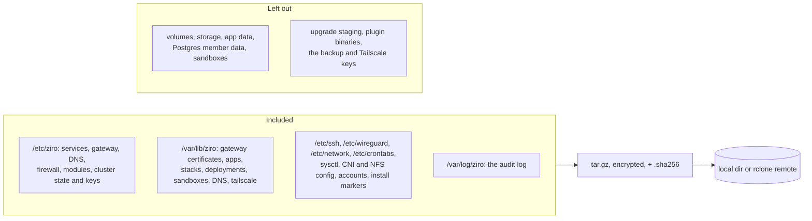

# Backup and restore

`ziroctl backup` saves the state of the host to one archive, and restores it onto the same host or a replacement.
A nightly backup runs by default, an upgrade or an update takes a snapshot first, and a restore takes one before it
changes anything.

```sh
ziroctl backup create                                  # /var/backups/ziro/ziro-backup-<date>.tar.gz.enc
ziroctl backup list
ziroctl backup verify ziro-backup-20261003-030000.tar.gz.enc
ziroctl backup restore ziro-backup-20261003-030000.tar.gz.enc --dry-run
ziroctl backup restore ziro-backup-20261003-030000.tar.gz.enc
```

Off-host copies go to any rclone remote (S3, GCS, Azure Blob, B2, SFTP, …) with the `rclone-ziro` module:

```sh
ziroctl module enable rclone-ziro                       # or s3-ziro, which also creates ziro_s3
ziroctl backup create --remote ziro_s3:ziro-backups
ziroctl backup restore ziro_s3:ziro-backups/ziro-backup-20261003-030000.tar.gz.enc
```

## What's in a backup



- **Everything the host needs to come back**, including the secrets: cluster app secrets, the Raft log, the CA and
  master keys, module secrets and rclone credentials. That is why the archive is encrypted.
- **Not included by default:** volumes, storage, app data (the databases of catalog apps and the data directories of
  Postgres clusters under `/var/lib/ziro/apps`) and sandboxes. A file copy of a running database is not consistent,
  so use `pg_dump` in a cron job, or snapshot the data disk. `--include-volumes` adds them anyway (large, and not
  crash-consistent).
- **Never included:** the backup key, the Tailscale node key (a restored copy would clone the node's identity),
  upgrade staging and plugin binaries.
- **Local accounts** (`/etc/passwd`, `shadow`, `group`) are in the archive, but a restore leaves them alone unless
  you pass `--users`, so an older archive cannot remove system users that a newer image added.

## The backup key

An archive is sealed with AES-256-GCM using the key in `/etc/ziro/backup.key`, made at the first backup. The key is
never inside an archive. **Copy it somewhere safe**, off this host: without it an encrypted backup cannot be opened,
here or on a replacement.

```sh
ziroctl backup key show                                 # prints the key; store it in your password manager
ziroctl backup restore ziro-backup-20261003-030000.tar.gz.enc --key-file /root/ziro-backup.key
```

`ziroctl backup create --no-secrets` makes a plain archive without cluster secrets, keys or storage credentials,
for the cases where an encrypted one is not wanted.

## Automatic backups and retention

- A nightly job (`ziroctl backup create --auto --keep 7`) is in the default crontab of new hosts. On an older host,
  add it: `ziroctl cron add -s '27 2 * * *' -c 'ziroctl backup create --auto --keep 7' -m nightly-backup`.
  A failed run is written to the audit log.
- `ziroctl upgrade`, `ziroctl update` and `ziroctl backup restore` save the current state first, as
  `…-preupgrade-…`, `…-preupdate-…` and `…-prerestore-…`. Retention counts these separately (`--keep-safety`, 5 by
  default), so a run of nightly backups never pushes them out.
- `ziroctl backup prune --keep 14` and `ziroctl backup rm <name>` clean up by hand.

## Restore safety

- A restore first checks the checksum, the allowlist and every authentication tag of the whole archive. A missing or
  wrong checksum is an error (exit code 1) unless you pass `--force`. `--dry-run` lists what would change.
- Only the paths listed above can be restored. Archives with path traversal, links that escape, devices or
  hardlinks are refused before anything is written.
- The files are then written over the live system, so the `prerestore` snapshot is the way back. Restart what
  changed afterwards: `ziroctl service restart <name>`, or reboot.
- To rebuild a cluster master, see [clustering](clustering.md). To rebuild a router planet, see
  [router-deploy](router-deploy.md).
