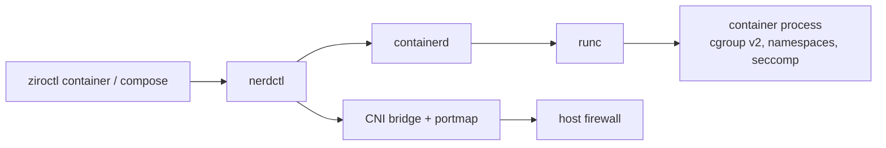

# Containers, Compose and scheduled jobs

Run containers directly on a host. For repeatable setups, use [stacks](provisioning.md) or [apps](apps.md). For
builds from git, use [deploy](deploy.md). On a cluster, use [cluster apps](clustering.md).

```sh
ziroctl container run -d --name web -p 8080:80 nginx:1.27
ziroctl container list
ziroctl container logs web
ziroctl container exec -it web sh
ziroctl container rm web
```

## How it works



- **No Docker daemon.** `ziroctl container` drives containerd through `nerdctl`, or falls back to `ctr`. Each
  container is a runc process in its own cgroup. Nothing long-running is added beyond containerd. Tools that need
  the Docker socket can use the opt-in [Docker API](#docker-api-socket). The `docker` command is nerdctl with
  [Docker-compatible version output](#the-docker-command).
- **Short image names** resolve like Docker: `nginx` becomes `docker.io/library/nginx:latest`, and
  `redis/redis-stack` becomes `docker.io/redis/redis-stack:latest`.
- **Networking:** containers join the CNI bridge by default (`--net` picks another). `-p host:container`
  publishes a port through CNI portmap. The host firewall still decides what is reachable from outside, so run
  `ziroctl firewall allow 8080/tcp` too.

## Containers

| Command | What it does |
|---|---|
| `container run [-d] [--name N] [-p H:C] [-e K=V] [--volume H:C] [--restart P] [--rm] [-it] IMAGE [CMD]` | Run a container |
| `container list` (`ls`, `ps`) / `images` | List containers / images |
| `container pull IMAGE` | Pull an image |
| `container logs N` / `inspect N` | Output / full configuration |
| `container exec [-it] N CMD` | Run a command inside |
| `container start` / `stop` / `restart` / `rm N...` | Lifecycle |

`ziroctl c` is short for `ziroctl container`, and `nerdctl` itself is also on the host for everything else.

## Compose

`ziroctl compose` is `nerdctl compose` with a safety check first. Every Compose command and flag works.

```sh
ziroctl compose up -d
ziroctl compose -f shop/compose.yaml ps
ziroctl compose logs -f web
ziroctl compose down
```

Before `up`, `create` and `run`, the file is checked. These are refused unless you pass `--allow-privileged`:

- `privileged`
- host network, pid or ipc
- `cap_add`
- `devices`
- unconfined `security_opt`
- bind mounts of `/`, `/etc`, `/proc`, `/sys`, `/dev`, `/run/containerd`, `/var/lib/ziro` or a socket

`build:` is refused: there's no image builder on a plain host. Build elsewhere and push, or enable the `builder`
module and use [`ziroctl deploy`](deploy.md). To import a Compose file as a stack, see
[provisioning](provisioning.md).

## Scheduled jobs

`ziroctl cron` manages root's crontab (`/etc/crontabs/root`), run by BusyBox crond.

```sh
ziroctl cron add -s '0 2 * * *' -c 'ziroctl backup create' -m nightly-backup
ziroctl cron list
ziroctl cron run 3          # run job 3 now
ziroctl cron remove 3
```

- **Format:** a job is one standard 5-field cron line. Newlines in a command are refused, so a job can't inject
  extra crontab entries.
- **Modules** add their own jobs, tagged `# ziro-module:<name>`, and remove them when disabled. Don't edit those
  lines by hand.

## Docker API socket

Some tools that manage a Docker host (Coolify's proxy, Traefik's Docker provider) talk to `/var/run/docker.sock`.
Ziro OS has no Docker daemon, so the socket is off. An administrator can turn on a small translation layer that
serves part of the Docker Engine API on `/run/docker.sock` (linked at `/var/run/docker.sock`) and runs the
matching `nerdctl` commands:

```bash
ziroctl docker-api enable
ziroctl docker-api status
ziroctl docker-api disable
```

Anyone who can use this socket is root on the host, so it is off by default, readable by root only, and never
mounted into apps, stacks, sandboxes or cluster replicas. Every call that changes something is written to the audit
log (`ziroctl audit`) with the user and process id the kernel recorded for the connection (`uid:0 pid:1234`).

The same switch is in the API: `GET /api/v1/docker-api` (any token) says whether the socket is enabled and answering,
and `POST /api/v1/docker-api/enable` and `/disable` (admin) turn it on and off.

Supported calls: `_ping`, `version`, `info` and `events`; containers (list, inspect, create, start, stop, restart,
kill, remove and logs); images (list, inspect and pull); volumes (list, inspect, create and remove, local driver);
networks (list, inspect, create and remove, bridge driver); and what `docker buildx` needs to build images: exec
(create, start over a hijacked connection, inspect; no terminal), copying a tar into a container (`PUT
/containers/{id}/archive`, regular files and directories only) and `POST /images/load`. Other calls, including
attach, the classic `/build`, stats and the registry auth header, answer `501` with the route in the message; pull
private images with `docker login` on the host. Container create maps the common fields (image, command,
entrypoint, environment, labels, ports, binds and mounts, networks and aliases, restart policy, memory, CPUs,
privileged, capabilities, DNS, tmpfs, sysctls) and ignores the rest, such as health checks and devices. The
design is RFC 0006 (`docs/design/rfcs`).

## The docker command

`docker` is a small wrapper around nerdctl, so Docker-style commands work. It changes only what tools that manage a
Docker host trip over:

- `docker version`, `docker --version` and `docker compose version` print Docker-shaped output, including
  `--format json` and Go templates such as `--format '{{.Server.Version}}'`. The server reports Docker Engine
  **24.0.0**: that is the API compatibility level of the [Docker API socket](#docker-api-socket) (API 1.43), not an
  installed Docker Engine. The real runtime (nerdctl, containerd, runc) is listed under `Components`.
- `docker network create --attachable` ignores the flag (every nerdctl network is attachable), and
  `docker compose pull --ignore-buildable` and `docker compose up --wait` drop the flag nerdctl does not know.
  nerdctl compose has no `--wait`, so `up --wait` returns once the containers are started and does not wait for
  health checks; it prints a note saying so.
- `docker run -d --rm` drops `--rm` (nerdctl refuses the two together) and prints a note: the container is not
  removed when it exits, so remove it with `docker rm -f`, as Coolify does for its helper container.
- `docker run --init` and `init: true` in a compose file work: the image carries `tini`.
- Everything else goes to nerdctl untouched. Ziro OS does not ship BuildKit, so `docker build` run on the host itself
  does not work. A tool that talks to the [socket](#docker-api-socket), such as Coolify's helper container running
  `docker compose build`, does: `docker buildx` starts its own `moby/buildkit` container (privileged, as in Docker),
  builds in it and loads the image into the host's store. The first build pulls that image (about 100 MB).

Because the socket gives exec and privileged containers, anyone who can use it is root on the host (it is root-only,
off by default, and every call that changes something, including each exec and the command it runs, is in the audit
log).
