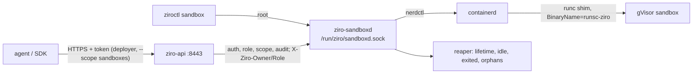

# RFC 0004: Sandboxes for untrusted code and AI agents

- **Status:** Draft (phases 1–6 implemented; later phases follow, one pull request each)
- **Pull request:** sandbox core (phase 1), then one per phase below

## Summary

Add **sandboxes**: disposable, strongly isolated containers that run untrusted code, such as an AI agent's tools, a
code interpreter or a CI step. They come from an opt-in `sandbox` module. The module runs gVisor and a small daemon,
`ziro-sandboxd`, which the CLI (`ziroctl sandbox`) and the REST API (`/api/v1/sandboxes`) both talk to. Later phases
add:

- a default-deny network policy
- an SSH gateway that authenticates with short-lived token sessions
- HTTPS port previews
- credential injection
- a Kata microVM runtime
- templates, warm pools and an MCP server for agents
- cluster placement

## Motivation

An agent that writes and runs code needs a machine it can't escape. A container under runc shares the host kernel
with everything else, so one kernel bug is a host compromise. Agents also need things a plain container doesn't give
them:

- a lifecycle API (create, exec, pause, delete)
- a lifetime, so forgotten machines go away
- quotas per caller
- network egress limited to what the task needs
- a way in for a person (SSH) or a browser (port previews)

We studied three platforms and kept what fits a minimal OS:

- **[NVIDIA OpenShell](https://docs.nvidia.com/openshell/latest/how-it-works/sandboxes/overview)**:
  - policy split into a static part (filesystem, process) and a dynamic part (network)
  - default-deny egress enforced outside the workload
  - credentials the agent only sees as placeholders
- **[OpenSandbox](https://github.com/opensandbox-group/OpenSandbox)**:
  - the lifecycle resource and its states
  - `renew-expiration`
  - egress control from a DNS proxy plus nftables sets, failing closed
- **[gVisor](https://github.com/google/gvisor)**:
  - a user-space kernel (`runsc`) that runs under containerd unchanged
  - the systrap platform works without KVM, so it runs inside cloud VMs and on arm64

We skipped Kubernetes CRDs, several compute drivers behind one gateway, OPA/L7 method rules and code-interpreter
contexts. A single host doesn't need them, and each would be a large dependency.

## Design

### Resource

```json
{"image": "python:3.13-slim", "runtime": "gvisor", "command": [], "env": {"TASK": "t1"},
 "user": "1000:1000", "workdir": "/workspace", "resources": {"memory": "2Gi", "cpus": 2, "pids": 512},
 "timeout": "30m", "idle_timeout": "10m", "metadata": {"agent": "claude"}}
```

- `sdk/schema.SandboxSpec` validates the spec at every boundary: CLI, API and SDK.
- The daemon then applies the host policy in `/etc/ziro/sandbox.json`:
  - default and maximum resources
  - default and maximum lifetime (1 h and 24 h)
  - a count per host and per owner, and an optional memory cap for all sandboxes together
  - an image policy (the cluster `ImagePolicy` format: registry allowlist and cosign signatures)
  - whether operators may pick `runc`
- States: `pending → running ⇄ paused`, or `failed`. Deleting a sandbox removes its record.

### Isolation (decided by the host, not the spec)

| Layer | Default |
|---|---|
| Kernel | gVisor `runsc --platform=systrap`: the workload's syscalls reach gVisor's kernel, not the host's |
| Privilege | `--cap-drop ALL`, plus a short list (chown, dac_override, fowner, fsetid, kill, net_bind_service, setgid, setuid) that applies inside gVisor; `no-new-privileges` |
| Resources | memory (no swap), cpus, pids, a 256 MiB `/tmp` tmpfs |
| Filesystem | the image's copy-on-write rootfs and a per-sandbox `/workspace`; no host mounts and no devices |
| Network | none by default (no interface); with a policy, a routed address whose egress is default-deny (see phase 2) |
| Lifetime | a timeout and an optional idle timeout; the reaper deletes expired sandboxes and audits it |

`runc` is available only when `allow_runc` is set on the host and the caller is an operator. Nothing in the spec can
add a mount, a device, a capability or a network: `sandboxRunArgs` builds the command line, and a test checks it.

### Components



- **`ziro-sandboxd`** is the `ziroctl` binary under another name, like `ziroctld`.
  - It owns the records (`/var/lib/ziro/sandbox/<id>/sandbox.json`, `0600`, next to the workspace) and the reaper.
  - It answers on a root-only unix socket.
- **The REST API** authenticates, checks the role and the token's scope, audits the request and forwards it.
  - It replaces the token with the caller's identity in `X-Ziro-Owner` and `X-Ziro-Role`, the same forwarding
    `ziroctld` uses (`daemonProxy`). A client can't set those headers: the proxy overwrites them.
- **The runtime** is gVisor's `runsc` behind a small wrapper (`runsc-ziro`) that sets the flags. nerdctl runs it
  through containerd's runc shim (`--runtime <path>`), the way Docker runs gVisor. That needs no change to the
  containerd configuration and no restart.
- **The module** downloads the pinned gVisor release tarball (sha256 from the release's `SHA256SUMS`) and keeps only
  `runsc`. To support this, module artifacts gain `extract`.

### Ownership and tokens

- A sandbox belongs to the token that created it. The host CLI counts as `root`.
- Deployers see and manage only their own sandboxes. Another owner's sandbox answers 404, so ids can't be probed.
  Operators and admins see all.
- API tokens gain optional **scopes**: `ziroctl api token create agent --role deployer --scope sandboxes` makes a
  token that can only reach `/api/v1/sandboxes`. That is the token to give an agent.

### API

| Route | Role | |
|---|---|---|
| `GET/POST /api/v1/sandboxes` | deployer | list (own) / create and wait until it runs |
| `GET/DELETE /api/v1/sandboxes/{id}` | deployer | show / delete with its workspace |
| `POST /api/v1/sandboxes/{id}/pause\|resume\|renew` | deployer | freeze / thaw / move the expiry |
| `PUT /api/v1/sandboxes/{id}/metadata` | deployer | replace metadata |
| `POST /api/v1/sandboxes/{id}/exec` | deployer | run a command, stream NDJSON output and the exit code |

The Go SDK (`sdk/client`) has a typed method for each route.

### Phases

Each phase is one pull request.

1. **Core**: the module, the daemon, the lifecycle, exec, scoped tokens (this RFC's first pull request).
2. **Network policy**:
   - `network: {mode: none|allowlist|open, allow: [...]}`
   - a dedicated CNI network
   - an nft table that drops traffic to other sandboxes, to the host, to link-local/metadata and to the LAN
   - a DNS responder that answers NXDOMAIN for denied names and fills the allowed sets (reusing `egress.go`)
   - hot reload; a sandbox fails closed if the rules can't be applied
3. **Access**:
   - an SSH gateway on `:22998` with token sessions in the username (`ssh -p 22998 zsbx_<token>@host`)
   - optionally bound to a public key
   - pty exec and `ssh -L` port forwarding, but no remote forwarding, agent forwarding or sftp
   - a files API confined to `/workspace` with `os.Root`
4. **Port previews**: `https://<port>-<id>.<gateway domain>` through the gateway, with signed expiring tokens for
   private ports.
5. **Credential injection**:
   - the sandbox sees `zsec_…` placeholders
   - a transparent egress proxy enforces the allowlist by SNI/Host and swaps placeholders only for the hosts a
     secret is bound to (MITM with a per-sandbox CA)
6. **Hardware isolation**: `runtime: gvisor-kvm`, gVisor on its KVM platform, where `/dev/kvm` exists.
   Kata was the first plan. Its official static bundle is about 1 GB (amd64) and 650 MB (arm64), which is out of
   proportion for this OS, while gVisor's KVM platform gives a hardware boundary with the binary already installed
   and no kernel change (both Ziro kernels have KVM). A slim Kata bundle can still be added later as another
   runtime.
7. **Agent platform**: templates, warm pools, snapshots (`nerdctl commit`), an MCP server (`ziroctl sandbox mcp`).
8. **Cluster**:
   - placement on runner nodes, with records in Raft
   - the API and SSH gateway forward to the node that owns a sandbox over the mesh with mTLS

## Security

**What becomes reachable.** Any `deployer` token (scoped or not) can run code in a sandbox on the host. The defaults
bound what that code can do:

- the gVisor kernel boundary
- no network
- resource limits
- a lifetime
- quotas per owner and per host

Exec, create and delete are audited by the API. Expiries are audited by the daemon.

**What an attacker who controls the spec could do.**
- Pick an image (limited by `image_policy`).
- Set env, user and workdir (validated, and passed as single arguments).
- Ask for resources up to the host limits.
- Command arguments always follow the image after `--`, so they can't become nerdctl flags.
- An image name can't start with `-`.

**Secrets.** Phase 1 has no secret store: `env` values are visible to anyone who can read the sandbox. Phase 5 adds
placeholders that never reach the sandbox.

**Residual risk.**
- gVisor bugs: a smaller surface than the host kernel, but not zero. Phase 6 adds microVMs for workloads that need a
  hardware boundary.
- Disk use inside the copy-on-write layer and `/workspace` isn't capped yet. This is marked `ponytail` and needs
  project quotas.

## Compatibility

- **New:** the module, routes, CLI and SDK methods.
- **API tokens** gain an optional `scopes` field. Older tokens have none and keep every route their role allows.
- **Module artifacts** gain an optional `extract`. Older manifests are unchanged.
- **`ziroctld`'s client code** moved into shared helpers (`unix_daemon.go`) without behaviour changes. Daemon errors
  now also show the API's `message` field.

## Alternatives

- **Firecracker as the default:** needs KVM, a guest kernel and an in-VM agent. It isn't available on arm64 hosts
  today or inside most cloud VMs. Kata covers microVMs in phase 6.
- **gVisor's own shim (`containerd-shim-runsc-v1`):** nerdctl passes no runtime options to a non-runc shim, so
  runsc's flags would have to come from a containerd configuration change (and a containerd restart). The runc shim
  with `runsc` as its binary is how Docker runs gVisor. It needs no containerd change.
- **An in-sandbox agent (`execd`/`envd`) for exec and files:** it adds a binary to every image and a listening port
  inside the sandbox. containerd's exec covers commands; phase 3 serves files from the host side.
- **Kubernetes CRDs and pools:** not needed on one node. Cluster placement in phase 8 uses the existing control plane.
