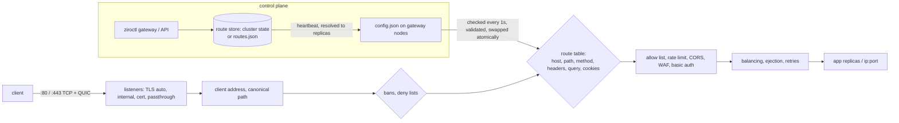

# Gateway (zirogate)

zirogate is the L4/L7 entry point of Ziro OS. It is part of `ziroctl` and runs as the `gateway` service. It terminates
TLS, routes HTTP and TCP traffic to apps and addresses, balances and protects the load, filters hostile requests, and
exports metrics. It needs no separate proxy image.

- On a standalone host it serves that host's routes.
- On a cluster it runs on the nodes you choose and serves the cluster's routes.

You manage it with `ziroctl gateway` or the [API](#api). Changes reach the running gateway within a second, and nothing
restarts.

| Area | What it provides |
|---|---|
| Routing | Host, path, regex, method, header, query and cookie matching; weighted canaries; redirects; fixed responses |
| Traffic management | Health checks, retries with a budget, outlier ejection, load shedding, timeouts, mirroring, rate limits |
| Security | Web application firewall, deny lists, bans, basic auth, trusted proxies, PROXY protocol |
| TLS | ACME (HTTP-01, TLS-ALPN-01, DNS-01), internal CA, uploaded certificates, passthrough, HTTP/3 |
| Observability | Prometheus metrics, JSON access log, W3C trace context, probes, alert rules |

## Quick start

```sh
# An app, or any ip:port, on a hostname, with HTTPS
ziroctl gateway expose web --host www.example.com
ziroctl apps deploy grafana --expose grafana.example.com      # deploy and publish together

# Routes with more control
ziroctl gateway route add api --host api.example.com --path /v1 --strip-prefix /v1 --app api \
    --lb least_conn --health /healthz@5s --retries 2 --compress --rate 100
ziroctl gateway route add canary --host www.example.com --app web:90 --app web-next:10
ziroctl gateway route add db --tcp --listen 5432 --app postgres --allow-cidr 10.0.0.0/8
ziroctl gateway route add mail --passthrough --host mail.example.com --to 10.0.0.9:443
ziroctl gateway route add old --host old.example.com --redirect 'https://www.example.com{uri}' --redirect-code 301
ziroctl gateway route ls
ziroctl gateway status
```

On a cluster, run these on the master and choose which nodes serve the routes with `ziroctl gateway node enable <node>`.
Point DNS for your hosts at the gateway nodes, or put a cloud load balancer in front of them
(see [Behind a load balancer](#behind-a-load-balancer)).

On a standalone host the first route starts the gateway and removing the last one stops it. A route's `--app` is a
local `apps` instance, reached at its published address; `--to` takes any `ip:port`.

`route add` with an existing name replaces that route. Routes that would match exactly the same traffic are refused.

## Routes

### Matching

A request matches a route when its host and every condition on the route hold.

| Flag | Condition |
|---|---|
| `--host` (repeatable) | An exact name, or `*.example.com`, which matches exactly one label |
| `--path` | A prefix, matched on `/` boundaries: `/api` matches `/api/x` but not `/apix`. `--exact` requires equality |
| `--path-regex` | An RE2 expression the path must also match |
| `--method` (repeatable) | One of these methods |
| `--header Name=value` | The header equals the value |
| `--header-match` | A header condition: `Name` (present), `Name=value`, `Name^=prefix` or `Name~=regex` |
| `--query`, `--cookie` | The same condition syntax for a query parameter or a cookie |

When several routes fit, an exact path wins over a prefix, a longer prefix over a shorter one, and a route with more
conditions over one with fewer. Ties go to the route defined first.

Paths are normalized before matching and forwarding: repeated slashes collapse and `.` and `..` segments are resolved,
so `/public/../admin` is matched, authenticated and forwarded as `/admin`. A path that contains control characters
gets a 400.

```sh
ziroctl gateway route add beta --host www.example.com --app web-beta --query beta --cookie tier^=gold
ziroctl gateway route add items --host api.example.com --app api --path-regex '^/v[0-9]+/items/[0-9]+$' \
    --header-match 'User-Agent~=^curl/'
```

### Targets and load balancing

`--app name[:weight]` and `--to ip:port[@weight]` are repeatable. An app's weight is spread over its replicas, so a
90/10 canary stays 90/10 however many replicas each side has.

| `--lb` | Behavior |
|---|---|
| `round_robin` | Weighted rotation (default) |
| `least_conn` | The target with the fewest requests in flight per unit of weight |
| `p2c` | Two random targets, the less loaded wins: nearly as even as `least_conn` without a shared hot spot |
| `ip_hash` | A client address stays on one target |
| `hash` | Consistent hashing on `--hash-key`: `ip`, `header:Name`, `cookie:Name` or `query:name`. When a target leaves, only its own keys move |
| `cookie` | Sticky sessions through `ziro_gw_<route>` (HttpOnly, Secure, SameSite=Lax). HTTPS routes only |

### Health, retries and ejection

- **Active checks.** `--health /path[@interval]` removes a target until it answers 2xx or 3xx again. On TCP routes the
  check is a TCP connect.
- **Passive ejection.** By default a target that fails a dial is skipped for 10 seconds. The outlier flags replace this
  with a policy that also counts timeouts and 502, 503 and 504 responses:

  ```sh
  ziroctl gateway route add api --host api.example.com --app api --retries 2 \
      --outlier-failures 5 --outlier-eject-for 30s --outlier-max-percent 50 --outlier-slow-start 30s
  ```

  After `--outlier-failures` failures in a row the target is ejected for `--outlier-eject-for`, doubling with each
  repeat up to 10 minutes. The gateway never ejects more than `--outlier-max-percent` of a route's targets, so a
  shared outage cannot empty the pool. A recovered target receives traffic gradually over `--outlier-slow-start`.
- **Retries.** `--retries N` (0 to 5) sends a request to another target after a failed attempt. A dial error is always
  retried for GET, HEAD and OPTIONS. `--retry-on 5xx,timeout,reset` adds those failures, for requests without a
  body. A request that may have reached an upstream and could have side effects is never resent.
- **Retry budget.** Retries are capped at `--retry-budget` percent of requests (default 20, with a reserve of 10), so a
  struggling upstream is not buried under retries on top of the load that hurt it.
- **Load shedding.** `--max-concurrent` limits requests in flight on a route and `--max-upstream-conns` limits them per
  target. Over the limit a request gets 503 with `Retry-After` and is counted as `shed`.

### Timeouts

| Flag | Limits |
|---|---|
| `--connect-timeout` | Reaching an upstream (default 5 s) |
| `--timeout` | Waiting for the upstream's response headers, per attempt (default 60 s) |
| `--request-timeout` | The whole exchange, streaming included (default none) |
| `--idle-timeout` | The longest silence from the upstream while streaming (default none) |

The server reads request headers within 10 s, a request body within 5 minutes, and keeps idle client connections for
120 s. Headers may total 64 KiB. Streaming responses (SSE, WebSocket, large downloads) have no write deadline; use
`--request-timeout` or `--idle-timeout` on routes where you want one.

### Request and response handling

- `--strip-prefix`, and `--rewrite 'pattern=>replacement'` for a regular expression over the path (`$1` for groups).
- `--set-header`, `--remove-header`, `--set-response-header` and `--remove-response-header`.
- `--compress` gzips compressible responses the upstream did not compress.
- `--security-headers` adds `X-Content-Type-Options`, `X-Frame-Options` and `Referrer-Policy` where the app set none.
- `--cors-origin` (repeatable) answers CORS preflights itself and adds the response headers for allowed origins.
  `--cors-methods`, `--cors-headers`, `--cors-expose`, `--cors-credentials` and `--cors-max-age` refine it.
  Credentials need explicit origins.
- `--max-body-mb` limits the request body (default 10 MB). A body over the limit gets 413, whether its length was
  declared or streamed.

The client's `Host` is preserved. `X-Forwarded-For`, `-Host` and `-Proto` are set by the gateway and replace whatever
the client sent. `X-Real-IP`, `True-Client-IP` and `X-Client-IP` are removed, so the upstream has one source for the
client address. `X-Request-ID` is kept when it is valid, or generated, and returned to the client.

### Other handlers

- `--redirect URL` with `{uri}` for the request URI, and `--redirect-code 301|302|307|308` (default 308).
- `--respond status[:body]` serves a fixed response, for example a maintenance page.

### Mirroring

`--mirror target[@percent]` sends a copy of matching requests to an app or `ip:port` and discards the answer. The copy
never delays or fails the real request. Requests with a body over 64 KB or of unknown length are not mirrored, at most
128 mirrored requests are in flight at once, and skipped copies are counted in
`zirogate_mirror_requests_total{result="skipped"}`. Mirrored requests carry `X-Mirror: 1` and the original headers,
credentials included, so mirror only to systems you trust.

### Upstream protocols

Upstreams speak HTTP/1.1 by default. `--upstream-proto https` connects over TLS and always verifies the certificate,
against the system roots or `--upstream-ca-file`, with `--upstream-server-name` when the upstream's name is not its
address. There is deliberately no option to skip verification. `--upstream-proto h2c` speaks HTTP/2 without TLS, for
gRPC services.

## Access control

Checks run in this order, and the first to refuse ends the request: bans, deny lists, `--allow-cidr`, rate limit, CORS
preflight, WAF, basic auth.

### Allow and deny lists

`--allow-cidr` admits only clients from the listed networks. `--deny-cidr` refuses listed clients even when an allow
list would admit them. A global list applies to every route:

```sh
ziroctl gateway settings set --deny-cidr 192.0.2.0/24 --deny-cidr 2001:db8:bad::/48
```

Lists are compiled to sorted address ranges, so a route with 100,000 networks costs about 17 comparisons per request.
A route holds up to 1,000 entries and the global list 10,000.

### Rate limits

`--rate` is requests per second per client, with a burst of `--rate-burst` (default: the rate, at least 10). Clients are
counted by address, with IPv6 clients sharing their /64, or by `--rate-key header:Name`, `cookie:Name` or `query:name`.
A client over the limit gets 429 with `Retry-After` and `RateLimit-*` headers. On TCP routes the limit applies to
new connections per second.

Limits are per gateway node: with three gateway nodes a client can make three times the rate overall. Limiter state
survives configuration reloads.

### Basic auth

```sh
ziroctl gateway route add admin --host admin.example.com --app admin --basic-auth-file /root/admin-users
```

The file holds `user:password` lines (passwords of 8 or more characters) and must not be readable by others.
`--basic-auth user:password` also works but shows the password in process listings. Passwords are stored as bcrypt
hashes. A verified credential is remembered for 5 minutes so a busy client does not pay for bcrypt on every request,
and each client has a budget of one failed attempt per second (burst 10) before it gets 429. Unknown users cost the same
as wrong passwords.

### Bans

```sh
ziroctl gateway ban add 203.0.113.0/24 --for 24h --reason scraper
ziroctl gateway ban ls
ziroctl gateway ban rm 203.0.113.0/24
```

A ban applies to every route on every gateway node. It lasts until removed, or for `--for`.

The gateway can also ban by itself. A client that is blocked by the WAF, or that guesses basic-auth passwords, earns a
strike. After the configured number of strikes within the window it is banned for a while, and for twice as long
each time it returns:

```sh
ziroctl gateway settings set --auto-ban --auto-ban-strikes 5 --auto-ban-window 1m --auto-ban-duration 10m --auto-ban-max 24h
```

Loopback and link-local addresses and trusted proxies are never banned. `--auto-ban-kernel` also adds the address to
the host firewall guard (see [security](security.md); `ziroctl security bans list`), which refuses it on every port, not
only the gateway's. Automatic bans
are kept by each node on its own; `ban ls` shows the bans of the gateway on the host where you run it.

## Web application firewall

The WAF inspects requests before they reach an upstream. Each rule that matches adds to a score, in the style of the
OWASP Core Rule Set: critical 5, error 4, warning 3, notice 2. A request is blocked when its score reaches the
threshold (5 by default), so one critical match blocks and two warnings do not. A blocked client gets 403 and no
explanation, only the request ID.

### Modes and rollout

| Mode | Behavior |
|---|---|
| `off` | No inspection, no cost |
| `detect` | Matches are logged and counted; every request passes |
| `block` | Requests reaching the threshold get 403 |

A route without its own `--waf` uses the gateway-wide default. Start in `detect`, watch
`zirogate_waf_matches_total` and the `waf` field of the access log, exclude rules that fire on legitimate traffic,
then switch to `block`:

```sh
ziroctl gateway settings set --waf detect
ziroctl gateway route add shop --host shop.example.com --app web --waf block --waf-exclude ZW-941160
ziroctl gateway route add upload --host files.example.com --app files --waf block --waf-skip-body
```

### What it detects

| Group | Covers |
|---|---|
| `sqli` | UNION SELECT, quote tautologies, stacked statements, time-based functions, catalog access |
| `xss` | Script tags, event handlers, script URIs, embedding tags, CSS expressions |
| `lfi` | Path traversal, sensitive files, stream wrappers |
| `rce` | Shell commands after separators, shell paths, PHP tags, dangerous functions, template injection, Shellshock |
| `java` | Log4Shell and JNDI lookups, class loading, OGNL, serialized objects |
| `xxe` | External entities and DTDs in XML |
| `ssrf` | Cloud metadata endpoints, dangerous URL schemes, URLs pointing at internal addresses |
| `scanner` | Known attack tools in the user agent, probes for sensitive paths |
| `protocol` | Unknown methods, TRACE, oversized URIs, many-range requests, the `Proxy` header (httpoxy), NUL bytes |

`ziroctl gateway waf rules` lists every rule in use with its ID (`ZW-942100`), group, level, score and stage. IDs are
stable.

Rules have a level. Level 1, the default, holds precise rules with few false positives. Level 2 adds broader rules and
level 3 adds paranoid ones, which flag more legitimate traffic (`--waf-level 2`). Exclude a rule or a whole group with
`--waf-exclude ZW-942100` or `--waf-exclude xss`.

### Updating the rules

The rules are data. A host starts with the rule set built into `ziroctl`; newer sets are published as a signed pack in
the [`ziro-os/pkgs`](https://github.com/ziro-os/pkgs) repository, so a new rule reaches gateways without a release.

```sh
ziroctl gateway waf update            # fetch, verify and install the newest rules now
ziroctl gateway waf update --check    # only report whether a newer pack is available
ziroctl gateway waf status            # the pack in use, its signature expiry, staged rules, rollback
ziroctl gateway waf rollback          # return to the previous pack
ziroctl gateway settings set --waf-auto-update=false
```

- **Instant.** `waf update` replaces the cached pack atomically. Every running gateway on the host notices within a
  second, rebuilds the routes that have a WAF, and swaps its route table. No restart, no dropped connection. On a
  cluster master the update also tells every gateway node to fetch the rules, so the whole cluster changes within one
  heartbeat. Rule content never travels through cluster state: each node downloads and verifies the pack itself.
- **Automatic.** Unless `--waf-auto-update=false`, each gateway checks for a newer pack about once a day (a day plus or
  minus an hour, so a fleet does not ask at once). Hosts that are offline keep the pack they have.
- **Trusted.** The pack's index is signed with the same key as the module catalog and pinned by sha256, like every
  catalog. An index older than its expiry, or with a lower serial than the one installed, is refused.
- **Checked before use.** A pack is installed only if it passes strict validation (at most 256 rules, RE2 expressions
  of at most 2 KiB, lower-case literals, known groups and targets), compiles, and every rule passes the `match` and
  `nomatch` samples it carries. A pack that fails any check is not installed: the rules in use stay, and a gateway
  that finds a damaged cache keeps its rules and raises an alert. A host with no valid pack uses the built-in rules.
- **Staged.** A rule can ship at the `detect` stage: it is logged and counted (`zirogate_waf_matches_total`, the `waf`
  field of the access log) but adds nothing to a request's score, so a new rule can be watched before it can block.
  `ziroctl gateway waf status` lists staged rules. A rule at the `off` stage does not run.
- **Reversible.** `waf rollback` reinstates the previous pack. The pack rolled back from is not installed again by the
  daily update, but a newer one is.
- **Stable.** Rule IDs keep their meaning. An exclusion naming a rule that a later pack retired is still accepted, so an
  update cannot make an existing route configuration invalid. The seven protocol rules inspect the request line and
  headers in code; a pack can change their score, level, stage and message but not their logic.

To add a rule, open a pull request to `ziro-os/pkgs` (see its `CONTRIBUTING.md`). The repository's CI runs
`ziroctl gateway waf test` on the rules file, signs the catalog and publishes it; the next `waf update` or daily check
picks it up. `--benign` also checks a list of legitimate requests, so a rule that would block known good traffic does
not ship. To check a rules file yourself:

```sh
ziroctl gateway waf test waf/zirogate-crs/rules.json --benign waf/zirogate-crs/benign.txt
ziroctl gateway waf export > rules.json     # the built-in rules, as a starting point
```

### What it inspects

The path, query arguments, cookie values, headers and the start of the request body. Values are normalized first:
percent-decoded up to twice, lower-cased, white space collapsed and comments replaced by a space, so
`UN/**/ION%20SELECT` and double-encoded payloads are seen as what they are.

Bodies of forms, JSON, XML, text and multipart uploads are read up to `--waf-body-kb` (default 8, at most 256) and
forwarded unchanged. For a body of unknown length the gateway waits for that many bytes before forwarding, so use
`--waf-skip-body` on routes that stream uploads. Binary content, gRPC and event streams are not read. WebSocket frames
are not inspected.

### Custom rules

A custom rule names a target, an operation and an action. They run before the built-in rules:

```sh
ziroctl gateway route add admin --host admin.example.com --app admin --waf block \
    --waf-rule '{"id":"office","target":"ip","op":"cidr","value":"203.0.113.0/24","action":"allow"}' \
    --waf-rule '{"id":"no-curl","target":"user_agent","op":"contains","value":"curl","action":"deny"}'
```

| Field | Values |
|---|---|
| `target` | `path`, `query`, `body`, `method`, `host`, `user_agent`, `ip`, `arg:NAME`, `header:Name`, `cookie:NAME` |
| `op` | `eq`, `contains`, `prefix`, `suffix`, `regex` (case-insensitive) or `cidr` (for `ip`) |
| `not` | Inverts the condition |
| `action` | `allow` (the WAF stands aside for this request), `deny`, `log`, or `score` with a `score` of 1 to 20 |

### Performance

The WAF scans each normalized part of a request once with an Aho-Corasick automaton and runs a rule's regular
expression only when one of the rule's literals occurs. Expressions are RE2, so inspection time is linear in the input
whatever an attacker sends. On a 2.1 GHz Xeon, a typical browser request (query, cookies and headers, about 600 bytes)
is inspected in about 3 µs on one core without allocating, and a small JSON POST in about 4 µs. In block mode
inspection stops as soon as the threshold is reached.

### Limits

The WAF is a filter for known attack patterns, not a substitute for fixing the application. It does not provide bot
scoring, geo-blocking or response inspection.

## TLS

`--tls` takes one of:

| Value | Certificate |
|---|---|
| `auto` (default) | Issued by ACME with HTTP-01 or TLS-ALPN-01. HTTP is redirected to HTTPS with a 308 |
| `internal` | The gateway's own CA, for private hosts. Trust it with `ziroctl gateway ca` |
| `cert:<name>` | An uploaded certificate, for wildcards and corporate CAs |
| `dns01` | Issued and renewed through ACME DNS-01, wildcards included, with no inbound port needed |
| `off` | Plain HTTP |

```sh
ziroctl gateway cert add wildcard --cert fullchain.pem --key privkey.pem
ziroctl gateway cert ls
ziroctl gateway route add site --host www.example.com --app web --tls cert:wildcard
ziroctl gateway acme --email ops@example.com
```

`dns01` needs a DNS provider and a certificate that covers the route's hosts (`ziroctl dns cert add '*.example.com'`);
see [dns](dns.md#wildcard-certificates-acme-dns-01). A `dns01` route is served only once its certificate exists.
A private ACME CA is set with `ziroctl gateway acme --directory <url>`; restart the `gateway` service after changing
ACME settings.

- TLS 1.2 is the minimum (1.3 for HTTP/3). HTTP/1.1, HTTP/2 and HTTP/3 (QUIC on udp/443, announced with `Alt-Svc`)
  are served. HTTPS responses carry HSTS unless the app sets its own header.
- Only the hosts of `auto` routes can trigger issuance, so a random SNI cannot make the gateway request a certificate.
- ACME cannot issue wildcards over HTTP-01. Wildcard hosts need `dns01`, `cert:<name>` or `internal`.
- The internal CA (ECDSA P-256) signs 30-day leaf certificates on demand: at most 50 new ones per second and 1,024
  cached, because a wildcard route answers for any name a client sends as SNI.
- With ACME every gateway node gets its own certificate, which counts against Let's Encrypt's limit of 50 per domain
  per week. With many gateway nodes use `dns01` (one certificate, issued by the cluster leader and shared as a
  cluster secret), `cert:<name>`, `internal` or a private ACME CA.

## TCP and TLS passthrough

- `--tcp --listen <port>` proxies raw TCP, for databases or any TCP service. Bans, deny lists, allow lists and
  per-client connection rates apply, and a target that fails a dial is skipped for 10 seconds.
- `--passthrough --host <name>` forwards TLS on :443 by SNI and the upstream terminates TLS. Hosts without a
  passthrough route are served by the HTTPS router as usual.

The gateway opens exactly the ports it serves in the host firewall, under the comment `Ziro gateway`: tcp/80, tcp/443,
udp/443 for HTTP/3, and each TCP route's port. It closes a TCP route's port when the route is removed.

## A base domain for deployed apps

Instead of an `--expose` per app, set one domain. Each deployed app without a host of its own is published at
`<app>.<domain>` when it is released.

```sh
ziroctl gateway domain set apps.example.com
ziroctl gateway domain
ziroctl gateway domain rm
```

- **TLS.** Public names get ACME certificates. `--wildcard-cert` makes it one wildcard certificate through DNS-01.
  Private names (`.local`, `.internal`, `.lan`, `.test`, `.home.arpa`, or no dot) use the gateway's own CA.
- **DNS.** Setting the domain adds `*.apps.example.com A <gateway address>` to the built-in DNS (see [dns](dns.md)):
  one record per gateway node on a cluster, a local record on a standalone host. With a
  [DNS provider](dns.md#public-dns-provider-cloudflare) connected, the public records are created and kept current;
  otherwise the command prints them.
- **Per app.** `ziroctl deploy ... --expose host` still wins over the domain.
- **Existing apps** take the domain on their next release. Removing the domain leaves the routes it created.

## Gateway-wide settings

```sh
ziroctl gateway settings
ziroctl gateway settings set --trusted-proxy 10.0.0.0/8 --proxy-protocol --drain-seconds 40
```

| Setting | Meaning |
|---|---|
| `--trusted-proxy` | Load balancers and CDNs in front of the gateway (addresses or CIDRs) |
| `--proxy-protocol` | Accept PROXY protocol v1 or v2 from trusted proxies |
| `--drain-seconds` | How long a stopping gateway waits for requests in flight (default 25, at most 60) |
| `--waf`, `--waf-*` | The default firewall of routes that have none |
| `--waf-auto-update` | Fetch new WAF rules about once a day (default on; `--waf-auto-update=false` to stop) |
| `--deny-cidr` | Networks refused on every route |
| `--auto-ban`, `--auto-ban-*` | Automatic bans |

### Behind a load balancer

Behind a load balancer every connection comes from the balancer, so allow lists, rate limits, bans and `ip_hash` would
all act on the balancer's address. Name the balancers as trusted proxies and the gateway takes the client address from
them:

- With `X-Forwarded-For`, the gateway reads the header from right to left, skipping trusted hops, and uses the first
  address that is not a trusted proxy. The header from any other peer is ignored.
- With `--proxy-protocol`, a connection from a trusted proxy must start with a PROXY protocol header; the address in it
  is the client. A malformed header closes the connection. Connections from other peers are served without one.
  PROXY protocol covers TCP, so HTTP/3 clients rely on `X-Forwarded-For`.

Configure the load balancer to send the header it is trusted for, and to health-check the gateway on tcp/80 or tcp/443.
The host guard limits connections per source address, so a balancer that funnels everyone through a few addresses may
need them in its allow list (`ziroctl security protect allow <cidr>`, see [security](security.md)).

## Observability

### Metrics

Prometheus metrics are at `http://127.0.0.1:2019/metrics`, and in the API server's `/api/v1/metrics` for the host's
gateway. To scrape a gateway over the network, add
`--metrics-listen :9090 --metrics-token-file /etc/ziro/gateway/metrics.token` to the `args` of
`/etc/ziro/services/gateway.conf`; the listener demands `Authorization: Bearer <token>`.

| Metric | Type | Labels | Meaning |
|---|---|---|---|
| `zirogate_requests_total` | counter | `route`, `code` | Requests and L4 connections by status |
| `zirogate_request_duration_seconds` | histogram | `route` | Time to serve a request |
| `zirogate_requests_in_flight` | gauge | `route` | Requests being served |
| `zirogate_request_bytes_total`, `zirogate_response_bytes_total` | counter | `route` | Bytes received (declared length) and sent |
| `zirogate_denied_total` | counter | `route`, `reason` | Refusals before an upstream: `acl`, `deny`, `ban`, `rate`, `auth`, `body`, `shed`, `waf`, `path`, `no_upstream` |
| `zirogate_upstream_request_duration_seconds` | histogram | `route` | Time to the upstream's response headers, per attempt |
| `zirogate_upstream_responses_total` | counter | `route`, `class` | Upstream responses by status class |
| `zirogate_upstream_errors_total`, `zirogate_upstream_failures_total` | counter | `route` (`upstream`) | Transport errors, and failed dials per upstream |
| `zirogate_retries_total` | counter | `route` | Requests sent to another upstream |
| `zirogate_outlier_ejections_total` | counter | `route` | Upstreams ejected |
| `zirogate_upstream_available` | gauge | `route`, `upstream` | 1 when the upstream takes traffic |
| `zirogate_upstream_active_requests` | gauge | `route`, `upstream` | Requests in flight to an upstream |
| `zirogate_upstream_healthy` | gauge | `route`, `upstream` | Result of the active health check |
| `zirogate_waf_matches_total` | counter | `route`, `group`, `action` | Requests with WAF matches; action is `log`, `detect` or `block` |
| `zirogate_waf_pack_info` | gauge | `pack`, `version`, `source` | The WAF rule pack in use (`builtin` or `catalog`) |
| `zirogate_waf_pack_serial`, `zirogate_waf_pack_expiry_seconds` | gauge | | Serial of the signed index the rules came from, and seconds until it expires |
| `zirogate_waf_pack_update_total` | counter | `result` | Rule pack fetches and loads: `ok`, `error`, `load_error` |
| `zirogate_mirror_requests_total` | counter | `route`, `result` | Mirrored requests: `ok`, `error`, `skipped` |
| `zirogate_bans_total`, `zirogate_bans_active` | counter, gauge | | Automatic bans issued, and in force |
| `zirogate_connections` | gauge | `kind` | Open client connections (`http`, `tcp`) |
| `zirogate_tls_handshakes_total` | counter | `version` | Completed TLS handshakes by protocol version |
| `zirogate_http3_handshakes_total` | counter | | Completed QUIC handshakes |
| `zirogate_cert_expiry_seconds` | gauge | `name` | Seconds until an uploaded certificate or the internal CA expires |
| `zirogate_config_reload_total` | counter | `result` | Reloads: `ok` or `rejected` |
| `zirogate_config_last_success_timestamp_seconds` | gauge | | When the configuration last loaded |
| `zirogate_ready`, `zirogate_uptime_seconds`, `zirogate_build_info` | gauge | | Status and build |
| `zirogate_log_dropped_total` | counter | | Access log lines dropped |
| `zirogate_go_*` | gauge | | Go runtime: goroutines, heap, GC cycles |

Label values are routes, status codes and a fixed set of reasons. Upstream labels are removed when an upstream leaves
the configuration, so churning pod addresses do not grow the series forever.

Examples:

```promql
# Error ratio per route
sum by (route) (rate(zirogate_requests_total{code=~"5.."}[5m])) / sum by (route) (rate(zirogate_requests_total[5m]))

# p99 latency per route
histogram_quantile(0.99, sum by (route, le) (rate(zirogate_request_duration_seconds_bucket[5m])))

# What the gateway refuses, and why
sum by (reason) (rate(zirogate_denied_total[5m]))
```

[`deploy/observability/zirogate-alerts.yml`](../deploy/observability/zirogate-alerts.yml) holds ready alert rules for a
down gateway, rejected configurations, error rate, latency, routes without a usable upstream, ejections, load shedding,
WAF spikes, expiring certificates and a lagging log.

### Probes and status

On the loopback admin port: `/healthz` answers while the process runs, `/readyz` answers 200 once a configuration is
loaded and 503 while the gateway drains, and `/status` (also `ziroctl gateway status` and `GET /api/v1/gateway/status`)
shows upstream health, active connections and requests per route.

### Access log

One JSON object per line in `/var/log/gateway.log`, written by a background writer. The request path never waits for
the disk: if the writer falls behind, lines are dropped and counted in `zirogate_log_dropped_total`.

| Field | Content |
|---|---|
| `ts`, `client`, `host`, `method`, `path` | When, who, and what. The query string is not logged |
| `status`, `bytes`, `ms` | Response status, bytes sent and duration |
| `route`, `upstream`, `upstream_status`, `upstream_ms` | The route and the upstream that answered, with its status and time |
| `request_id`, `trace_id` | Correlation identifiers |
| `user_agent`, `tls` | The user agent (truncated) and TLS version |
| `waf` | `block:`, `detect:` or `log:` followed by the matched rule IDs |

Values from the request are escaped, so a hostile request cannot forge log lines. Health changes are logged as events.

### Trace context

The gateway continues a W3C `traceparent` header (or starts a trace), gives the upstream hop its own span ID, and logs
the trace ID. `tracestate` passes through unchanged.

## Operations

### Reloading and shutdown

The gateway checks its configuration every second. A new configuration is validated completely and swapped in
atomically; an invalid one is rejected, counted, reported once as an alert, and the previous routes keep serving.
A route that did not change keeps its rate-limit state, counters and health. Requests in flight finish on the table
they started with.

On SIGTERM (`ziroctl service stop gateway`, a restart, or a reboot) the gateway stops accepting new connections, fails
`/readyz`, and lets requests and TCP connections in flight finish for up to the drain time (25 s by default). The
service manager waits up to 65 s before it kills the process. WebSocket connections are not tracked by the HTTP server
and end when the process exits.

### Sizing

The cost of the gateway itself, measured in process with an in-memory upstream on a 4 vCPU 2.1 GHz Xeon (the figures
exclude TLS and the network):

| Case | One core | Four cores |
|---|---|---|
| Route match, policy, balancing and proxy | 7 µs, 39 allocations | 3 µs |
| The same with the WAF in block mode | 14 µs | 6 µs |

A request does not take a lock, and the access log, metrics and counters are written without blocking. In practice a
node is limited by TLS handshakes, the network and the upstreams before it is limited by the gateway. Ten million
requests a day is about 115 per second on average, a small fraction of one core.

To measure your own build:

```sh
cd tools/ziroctl && go test ./cmd -run xxx -bench 'GatewayHandler|WAFInspect' -benchmem -cpu 1,4
```

For a real load test, run a generator such as `wrk` or `vegeta` against a staging node and watch
`zirogate_request_duration_seconds`, `zirogate_requests_in_flight` and the host's CPU.

### Several gateway nodes

Routes, certificates, settings and manual bans are shared by all gateway nodes. Rate limits, automatic bans and metrics
are per node. WAF rule packs are fetched and verified by each node; `waf update` on the cluster master makes every node
fetch at once.

## Architecture



1. **Storage.** Routes live in a store: the cluster state on the master, or `/etc/ziro/gateway/routes.json` (0600) on a
   standalone host. The CLI, the API and the gateway validate with the same rules.
2. **Resolving apps.** Every heartbeat the master resolves each app to its running replicas (pod IPs and the container
   port on a pod network, otherwise mesh IP and host port). A standalone gateway resolves local apps to their
   published address.
3. **Delivery.** Gateway nodes receive the resolved routes in their heartbeat (`/run/ziro/gateway/config.json`, 0600,
   tmpfs). Certificates and the internal CA key are cluster secrets, sealed at rest and sent only to gateway nodes.
4. **Serving.** The route table is an immutable snapshot behind an atomic pointer, so lookups take no lock. Upstream
   state, rate limiters and metrics are lock-free or sharded.
5. **Policy.** On a cluster, routing an app counts as consent to expose it: gateway nodes become allowed sources in its
   network policy. `--expose` on a cluster publishes the app's port on the mesh only.

## API

The API server exposes the gateway behind its tokens. Any token can read; changes need `admin`. Every change is audited.

```text
GET    /api/v1/gateway/routes              resolved routes and upstreams
POST   /api/v1/gateway/routes              create or replace (JSON route, unknown fields refused)
GET    /api/v1/gateway/routes/{name}
PUT    /api/v1/gateway/routes/{name}
DELETE /api/v1/gateway/routes/{name}
GET    /api/v1/gateway/status              upstream health, active connections, requests per route
GET    /api/v1/gateway/settings            trusted proxies, WAF default, deny list, bans policy
PUT    /api/v1/gateway/settings
GET    /api/v1/gateway/bans                manual bans, and the automatic bans of this host's gateway
POST   /api/v1/gateway/bans                {"addr","for","reason"}
DELETE /api/v1/gateway/bans/{addr}         escape "/" in a CIDR as %2F
GET    /api/v1/gateway/waf/rules           the rules in use
GET    /api/v1/gateway/waf/pack            the installed rule pack, staged rules, rollback availability
POST   /api/v1/gateway/waf/update          fetch and install the newest signed rule pack
POST   /api/v1/gateway/waf/rollback        return to the previous rule pack
GET    /api/v1/gateway/domain              the base domain of deployed apps, gateway addresses, DNS records
PUT    /api/v1/gateway/domain              {"name":"apps.example.com"}
DELETE /api/v1/gateway/domain
GET    /api/v1/gateway/ca                  internal CA certificate (PEM)
GET    /api/v1/gateway/certs               POST {"name","cert","key"}   DELETE /api/v1/gateway/certs/{name}
```

The public DNS provider is managed under `/api/v1/dns/cloud` (see [dns](dns.md)). The full schema is in
[`sdk/openapi.yaml`](../sdk/openapi.yaml).

```sh
curl -H "Authorization: Bearer $TOKEN" -X PUT https://host:8443/api/v1/gateway/routes/api -d '{
  "hosts": ["api.example.com"], "path_prefix": "/v1", "strip_prefix": "/v1",
  "to": [{"app": "api", "weight": 90}, {"app": "api-next", "weight": 10}],
  "lb": "least_conn", "health": {"path": "/healthz", "interval": "5s"}, "retries": 2, "compress": true,
  "waf": {"mode": "block"}}'
```

`POST /api/v1/apps/deploy` also accepts `"expose": "<host>"`.

## Security model and limits

- **Config trust.** The configuration is written by root (the agent or `ziroctl`), but the gateway validates everything
  again when it loads it, and rejects a bad file as a whole.
- **Request normalization.** The path, host and client address are canonicalized before any rule sees them. Request
  smuggling is prevented by Go's HTTP server, which rejects ambiguous framing, and by building the upstream request
  anew from the parsed one.
- **Identity.** The client address is the TCP peer unless the peer is a trusted proxy. No other header can claim it.
- **Secrets.** Basic-auth passwords and private keys are stored as bcrypt hashes and root-only files or cluster secrets.
  The admin port is loopback only, and lifting an automatic ban needs a token that only root can read.
- **Bounded resources.** Rate-limit, ban, certificate and metric state is capped and swept. Headers, request bodies and
  the WAF's inspection are bounded.
- **Network exposure.** The metrics listener serves plain HTTP with a bearer token; keep it on a private network.

Known limitations:

- Rate limits, automatic bans and metrics are per gateway node.
- HTTP/3 clients behind a UDP load balancer are identified by `X-Forwarded-For` only.
- There is no response caching, JWT or forward authentication, client-certificate authentication, geo-blocking or
  UDP routing.
- The WAF does not inspect WebSocket frames, bodies beyond its inspection limit, or responses.

## Remote access (WireGuard peers)

Laptops, CI runners and other sites can join the mesh as WireGuard clients of the hub, the first gateway node by ID.

```sh
# On the client (recommended: the private key never leaves it)
wg genkey | tee client.key | wg pubkey            # prints <pubkey>

# On the master
ziroctl gateway peer add alice --pubkey <pubkey> --output alice.conf   # add --endpoint vpn.example.com:51821 behind NAT
ziroctl cluster deploy --name api --allow-from web,peer:alice          # or 'peers' for every peer
ziroctl gateway peer ls
ziroctl gateway peer rm alice                                          # revoke
```

Put the client's private key into `alice.conf` and run `wg-quick up ./alice.conf`. Without `--pubkey`, the master
generates a key pair and prints the private key once; it is never stored. Running `peer add` again with the same name
rotates the key and keeps the mesh IP.

- The peer gets a mesh IP from the mesh CIDR, and its `AllowedIPs` is the whole mesh.
- The hub holds it as an endpoint-less WireGuard peer and relays its traffic into `ziro0`. Every other node routes the
  peer's /32 back through the hub.
- The hub only relays: its forward chain admits the peer's traffic as transit. Each destination node still enforces
  `allow_from`, so under the default deny a peer reaches nothing until an app names it. Clusters in `allow` mode give
  peers the whole mesh.
- `ziroctl audit log` records `peer add` and `peer rm` with the public key; the private key is not recorded.
- There is one hub. If the first gateway node changes, clients need a new config (`peer add` again).
- Peers get no DNS for `<app>.cluster.ziro`. Use mesh IPs from `ziroctl cluster endpoints`.

## Upgrading from earlier versions

These behaviors changed:

- Request paths are normalized before matching and forwarding. A route that relied on `//` or `..` segments reaching
  the upstream unchanged needs the upstream path written plainly.
- A request body over the limit always gets 413 (streamed bodies used to get 502).
- The server no longer has a 5-minute read timeout. A request body must still arrive within 5 minutes.
- `X-Real-IP`, `True-Client-IP` and `X-Client-IP` are no longer passed to upstreams. Read `X-Forwarded-For`.
- Stopping the gateway drains instead of cutting connections, and the service manager waits up to 65 seconds for it.
- Rate-limit state and round-robin position now survive configuration reloads.
- Ejection of failing upstreams is unchanged unless a route sets the outlier flags.
- WAF rules update by themselves once a day when a signed pack is published, and a rule added to the pack can start
  blocking at the next check. New rules are published at the `detect` stage first when they might match legitimate
  traffic. To keep the rules fixed, run `ziroctl gateway settings set --waf-auto-update=false`; use
  `ziroctl gateway waf rollback` to return to the previous pack.
