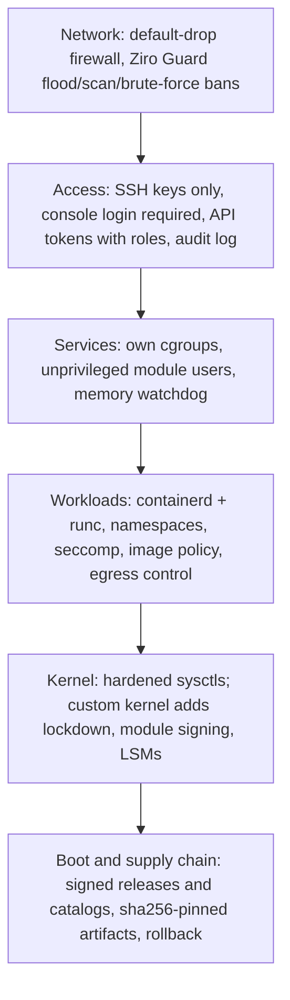

# Security and hardening model

Security is a design constraint of Ziro OS. General-purpose distributions run many background daemons, cron jobs and
services by default. Ziro OS keeps the default host small, so there is less to attack.

## Lock down a host

```sh
ziroctl ssh key import gh:alice               # keys from GitHub, GitLab (gl:) or Launchpad (lp:)
ziroctl firewall enable                       # default drop; SSH (22), WireGuard (51820/udp), ICMP stay open
ziroctl firewall allow 443/tcp --comment web
ziroctl firewall allow 22 --iface tailscale0    # only traffic arriving on that interface
ziroctl firewall block-ip 198.51.100.0/24 --comment scanner
ziroctl firewall status
ziroctl security audit                        # check the hardening
```

| Command | What it does |
|---|---|
| `firewall enable` / `disable` / `status` / `list` | Default-drop inbound firewall (its own `inet ziro` nftables table) |
| `firewall allow` / `deny <port[/proto]>` | Open or close a port |
| `firewall block-ip` / `unblock-ip <ip-or-cidr>` | Drop everything from an address |
| `security protect set --synproxy 80,443` | The kernel completes TCP handshakes to these host ports with SYN cookies (see below) |
| `firewall flowtable <interface>... \| off` | Fast path for established forwarded flows (see below) |
| `ssh key import <gh:u\|gl:u\|lp:u>... [--sync]` | Authorize published keys; `--sync` drops the ones the user removed upstream |
| `ssh key add` / `list` / `remove --source` / `clear` | Manage root's authorized keys |
| `ssh status` | sshd state and host key fingerprints |

## SYN flood protection and the forwarding fast path

Two kernel features, both off until you ask for them.

**SYN proxy.** Under a SYN flood every half-open connection costs the host connection-tracking state. With a SYN proxy
the kernel answers a SYN with a cookie and creates the connection only when the client's ACK proves its address is
real, so a flood costs nothing but the replies.

```sh
ziroctl security protect set --synproxy 80,443      # ports of services on this host, such as the gateway
ziroctl security protect set --no-synproxy
```

- List only ports served by a process **on this host** (the gateway, `sshd`). Do not list a port a container
  publishes with `-p`: the proxy handles the handshake before address translation, so those connections would not
  be translated.
- The per-source limits of Ziro Guard still apply first. Trusted interfaces, the mesh, containers' bridges and the
  Guard allowlist skip the proxy, as they skip the limits.
- Turning it on sets `nf_conntrack_tcp_loose=0` (a packet in the middle of a connection no longer creates one), and
  `tcp_syncookies` and `tcp_timestamps` to 1.
- It needs the `nft_synproxy` kernel feature; the custom kernel has it built in.

**Flow offload.** Once a forwarded TCP or UDP connection is established, its packets can skip most of the netfilter
hooks and go straight from one interface to the other. It helps routed and NATed traffic (containers reaching out, the
mesh), not traffic to this host.

```sh
ziroctl firewall flowtable eth0 nerdctl0            # the uplink and the container bridge
ziroctl firewall flowtable                          # show the setting
ziroctl firewall flowtable off
```

- Name the interfaces the traffic crosses. An interface that does not exist yet is skipped with a message and picked
  up the next time the firewall is applied (`ziroctl firewall apply`).
- It lives in its own table (`inet ziro_flow`), so a failure to load it never affects the firewall. The counter in
  `nft list chain inet ziro_flow forward` shows how many packets still take the slow path: an offloaded flow is seen
  only at its start.
- API: `PUT /api/v1/firewall/flowtable` with `{"interfaces": ["eth0", "nerdctl0"]}` (admin).

## Defense layers



## Security principles

### 1. Minimal attack surface

- Full hosts include containerd/runc/CNI, OpenSSH, apk/ziropkg, and enabled host services.
- The minimal container base starts `/bin/sh`; optional API and cluster listeners require configuration.

### 2. Immutable root filesystem

- Immutable root is a design target. The current installer mounts ext4 read/write; live boot uses writable tmpfs.
- `/run` and `/tmp` use tmpfs. Deployments requiring immutable root must provide and verify that enforcement.

### 3. Unified cgroups v2 and namespaces

- PID 1 enables cgroup2 controllers. Every service runs in its own cgroup: platform daemons in `ziro/system`
  (memory reservation, OOM score -900), module services in `ziro/workloads` (OOM score +300). Modules and apps
  declare `resources` (memory, CPUs, PIDs), enforced by the kernel; a sentinel watchdog reacts to sustained memory
  pressure. See [operations](operations.md#memory-how-a-host-protects-itself).
- Namespace and seccomp support must be paired with verified runtime settings; host binds, privileged mode,
  runtime sockets, and host networking grant additional authority. Local `ctr` fallback uses host networking.

### 4. Kernel seccomp and capability restrictions

- Kernel configurations explicitly enable `CONFIG_SECCOMP` and `CONFIG_SECCOMP_FILTER`.
- Runtime policy must restrict capabilities and device access. Verify the effective configuration for each workload.

### 5. Network hardening (sysctl)

Configured in `/etc/sysctl.d/99-ziro.conf`:

- `net.ipv4.conf.all.forwarding = 1`: Controlled IP forwarding for CNI bridge networks.
- `net.bridge.bridge-nf-call-iptables = 1`: Netfilter packet filtering across container bridges.
- Automatic recovery parameters (`kernel.panic = 10`, `kernel.panic_on_oops = 1`).
- Connection tracking and socket limits for busy hosts: a 262144-entry conntrack table, established flows that
  expire after a day, `tcp_tw_reuse`, a 30 s `tcp_fin_timeout` and `fs.file-max`.

The firewall keeps blocked sources in nftables interval sets (`blocked4`, `blocked6`) and groups unscoped allowed ports
into one rule per protocol, so lookup cost does not grow with the length of the lists.

## Running security audits

Check the hardening of a running host with `ziroctl`:

```bash
ziroctl security audit
```

Example output:

```text
=== Ziro OS Security & Hardening Audit ===
 [PASS] Kernel Seccomp Support
 [PASS] Namespaces Enabled (pid, net, ipc, uts, user, mnt)
 [PASS] Unified cgroups v2 Hierarchy
 [PASS] Container IPv4 Forwarding Enabled
 [PASS] /tmp sticky bit configured correctly
```

## Secure defaults

- **Console login**: installed systems always require `login` on tty1/ttyS0/ttyAMA0. A locked or empty root
  password means no console login. An unauthenticated root shell exists only on the live ISO, or with the exact
  `ziro.recovery` kernel argument. Anyone who can pick the GRUB "recovery" entry gets root, so set a GRUB
  password on shared consoles.
- **Cloud access**: the `cloud-init` service (autostart) uses IMDSv2 to install instance SSH keys into
  `/root/.ssh/authorized_keys` and runs shell user-data once per instance. It only trusts `169.254.169.254` on
  EC2-compatible clouds detected by DMI (override with `touch /etc/ziro/cloud-init.force`).
- **Services**: `ziro-init` starts every enabled service (`ziroctl service boot`), so the firewall and Sentinel
  are active from boot. A service's PID is only signaled when its argv matches the service definition, or, for
  a daemon that rewrites its title (sshd), when its pidfile names a process running that exact binary.
  - `ziro-init` itself supervises containerd and sshd. `ziroctl service stop` leaves a marker in
    `/run/ziro/stopped/`, which holds init's restart, and `start` removes the marker so init respawns the daemon.
  - `restart` validates the config first (`check=` in the definition; sshd uses `sshd -t`). A broken
    `sshd_config` is refused and the running sshd is kept, so a typo can't lock you out.
  - `start` reports a daemon that exits during its first second, instead of claiming success.
- **Firewall**: rules live in their own `inet ziro` nftables table. CNI, nerdctl, WireGuard and kube-proxy rules
  are never flushed. ICMP/ICMPv6 are allowed, and so is SSH (22). Inputs are validated, and nft errors are reported.
- **REST API**: binds `127.0.0.1:8443` by default, CORS is off, and tokens are checked in constant time and never
  logged. To expose it: `ziroctl api start --bind 0.0.0.0` plus `ziroctl firewall allow 8443`.
  - Tokens are scoped: `ziroctl api token create <name> --role viewer|deployer|operator|admin [--ttl 90d]` prints
    the token once. Only its SHA-256 is stored (`/etc/ziro/api-tokens.json`, 0600).
  - Every route declares its role, and the server enforces exactly that (each operation's `x-ziro-role` in
    `sdk/openapi.yaml`; a test keeps the two identical).
    - `viewer` reads.
    - `deployer` also pushes source, redeploys and rolls back deployments (CI, agents).
    - `operator` also runs day-to-day changes: services, containers, DNS records, scaling, cordon/drain.
    - `admin` is needed for anything that grants or removes access, installs software, deletes data, or changes
      where traffic or lookups go (hostname and resolvers included).
  - Tokens expire (90 days by default). `ziroctl api token ls` lists them and `ziroctl api token revoke` removes one.
  - Every change is audited under the token's name, with its result. `GET /api/v1/events` streams the audit trail.
  - **Rate limits:** 120 requests per minute per client address and 600 per token.
  - **Errors:** always JSON, `{"status": "error", "code", "message"}`.
  - **Bootstrap token:**
    - The first start creates one admin token (`/etc/ziro/api.token`) only if no scoped token exists.
    - Once scoped tokens exist, none is created.
    - `ziroctl api token revoke legacy` retires it for good.
  - **TLS certificate:**
    - Self-signed ECDSA P-256, TLS 1.2 minimum.
    - Renewed automatically 30 days before it expires, and when the host's addresses change.
- **Sentinel**: alert-only by default. Use `ziroctl security monitor --enforce` to SIGKILL CRITICAL detections.
  File integrity is checked against a baseline in `/etc/ziro/fim.db`. Refresh it after upgrades with
  `ziroctl security harden`.
- **Ziro Guard (flood, scan and brute-force protection)**: on whenever the firewall is on
  (`ziroctl security protect status|set|allow|disallow|enable|disable`).
  - It lives in its own `inet ziro_guard` nftables table that firewall changes never delete, so bans keep their
    remaining time and expire in the kernel.
  - Per source address: new TCP connections over 100/s, more than 256 concurrent connections, or ICMP over 20/s
    are dropped.
  - Port scans (SYNs to closed ports over 20/min, with a default-drop firewall) are banned for 10 minutes by the
    kernel itself.
  - Sentinel bans SSH sources after 5 failures in 10 minutes: 1 hour first, doubling for repeat offenders up to 24
    hours. It counts OpenSSH's own PerSourcePenalties lines too, but never penalties for connections that don't
    try to log in (load balancer health checks).
  - The source address is taken from where sshd writes it, so a crafted username cannot frame another address.
  - Banned addresses cannot reach published container ports either.
  - Never limited: loopback, link-local, the cluster mesh (`ziro0`), container bridges and `protect allow` CIDRs.
  - Manage bans with `ziroctl security bans list|ban|unban`, or `GET/POST /api/v1/security/bans` (changes need an
    admin token).
- **Gateway firewall.** The gateway can screen requests with a web application firewall (SQL injection, XSS, path
  traversal, command injection, Log4Shell, XXE, SSRF, scanners), refuse deny-listed and banned clients, and ban
  repeat offenders by itself. It takes the client address from trusted proxies only. See [gateway](gateway.md).
- **Security alerting**: `ziroctl security alerting add <name> --url https://... [--min-severity high]
  [--events ban,threat,fim,canary,gateway] [--format json|slack]` pushes Sentinel threats, file-integrity and canary
  changes, and bans to webhooks.
  - Each request is signed: `X-Ziro-Signature: sha256=HMAC-SHA256(secret, X-Ziro-Timestamp + "." + body)`. The
    secret is shown once at creation. Reject stale timestamps to stop replays.
  - Alerts are queued in `/var/lib/ziro/alerts` and retried with backoff for 24 hours. The same alert is sent at
    most once per 10 minutes.
  - Webhooks must be HTTPS (plain HTTP only to loopback), and redirects are not followed.
  - The API (`/api/v1/security/alerting`) is admin-only.
- **Container defaults**: cluster containers run with `no-new-privileges` and without `NET_RAW` (no raw-socket
  spoofing). `cluster deploy --allow-privilege-escalation` opts an app out.
- **SSH key import**: `ziroctl ssh key import gh:<user> [gl:<user>] [lp:<user>]` fetches published keys over HTTPS
  from fixed provider URLs. The username is validated, the response is capped at 64 KB, and redirects are only
  followed on the same host. DSA keys and RSA keys under 2048 bits are rejected, and so are keys with options.
  Keys are deduplicated by fingerprint and tagged `ziro-import:<src>:<user>`. `--sync` also removes keys the user
  deleted upstream, but never syncs to an empty list, so you can't be locked out. `ssh key remove --source
  gh:<user>` removes every key from that source. `/api/v1/ssh/keys` is admin-only.
- **DNS and egress**: the optional smart DNS (`ziroctl dns enable`) only answers loopback and allowed networks. It
  rate-limits clients, verifies DNS-over-TLS certificates and can block domains. Apps deployed with `--egress`
  reach only their allowed domains and CIDRs; see [dns.md](dns.md).
- **Security modules** (opt-in, never preinstalled): `ziroctl module enable security` installs the `clamav`
  antivirus (clamd on a local socket, signature updates, daily scans, `security scan --av`, `av` alerts) and
  `auditd` (a CIS-aligned kernel audit trail), `integrity` (IMA: what the host runs is checked daily against the OS
  image and signed packages; `ziroctl security integrity`), and `clamav-onaccess` (blocks opening infected
  files). See [modules.md](modules.md).
- **Hardening score**: `ziroctl security audit [--json]` scores the host against 30 CIS-mapped checks (kernel and
  network sysctls, SSH, firewall and guard, file permissions, audit chain). Fresh images score 100.
- **Backups**: archives are root-only (0600) and unencrypted, and they contain private keys. Restore rejects
  paths outside the backup allowlist, traversal, hardlinks, and writes through symlinks.
  Creation stages bytes in a private file, publishes the finished archive atomically, and refuses existing
  archive/checksum destinations. Output filesystems must enforce 0600 permissions and support hard links
  (for example ext4); unsupported filesystems fail before archiving secrets. Choose a trusted directory.
- **Clustering**: joins pin the cluster CA (by hash) plus a join token, and each node gets its own token (masters
  store only hashes). Masters hold CA-signed certificates issued from CSRs. Raft (tcp/7444) and master-to-master
  API calls require mutual TLS with those certificates, and workers can never obtain one. ziroctl reaches its
  local cluster-master through a root-only unix socket. Backups leave out the Raft data, the CA key and the
  master key. See [clustering.md](clustering.md).
  A replica is reported running only when its assigned Ready node reports it.
- **Cluster network policy**: new clusters default to `deny`. Mesh traffic reaches an app's port only from nodes
  that run an app listed in its `allow_from` (`ziroctl cluster deploy --allow-from web`). On the pod network
  (default for new clusters) that means from the allowed apps' own replica IPs, including same-node traffic. It
  is enforced in each node's `inet ziro_cluster` nftables table, and the agent does not configure the mesh until that
  table is in
  place. Check it with `ziroctl cluster policy ls`.
- **Image policy**: `ziroctl cluster policy images` limits apps to allowed registries and can require cosign
  signatures by your keys. Verified images are pinned by digest, so nodes run exactly what was verified. The leader
  re-checks every changed image. See [clustering.md](clustering.md#image-policy).
- **Secrets at rest**: cluster secrets and the CA key are sealed (AES-256-GCM) with a cluster data key in Raft,
  snapshots and files. Each master wraps its copy with a `file`, `tpm` (TPM 2.0, salted and encrypted sessions)
  or `command` (KMS/Vault/HSM) provider. Masters fetch the key from each other only over mutual TLS, and every
  fetch is audited. See [clustering.md](clustering.md#secrets-at-rest).
- **Monitoring and compliance**: `GET /api/v1/metrics` (Prometheus text format; a `viewer` token is enough) reports
  host health, service state and, on masters, node readiness, replica health, control-plane membership and which
  security controls are in force. [compliance.md](compliance.md) maps the controls to NIST SP 800-190, CIS Controls
  v8 and SOC 2, with the command that produces evidence for each and the known gaps.
- **Credential rotation**: node tokens rotate automatically every 30 days, and at once with
  `ziroctl cluster rotate tokens`. The agent generates the new token and sends it over the authenticated channel. The
  previous token stays valid for an hour, and using it triggers another rotation, so a lost reply never locks a node
  out. Master certificates renew 30 days before expiry, and at once with `ziroctl cluster rotate certs`. The cluster
  data key rotates with `ziroctl cluster keys rotate`: it is distributed to every master before the secrets are
  re-sealed, then the old key is dropped and the Raft log compacted. Rotating the cluster CA is not supported yet;
  it is valid for 10 years.
- **Audit log**: every mutating `ziroctl` command run as root, ziro-api service action, and cluster join, leave
  or rejected credential is appended to `/var/log/ziro/audit.log` (0600). Each record holds the SHA-256 of the
  previous one. `ziroctl audit verify` exits non-zero at the first changed or removed record, and
  `ziroctl audit log --since 24h --json` exports records. `KEY=VALUE` values and credential flags are redacted.
  The log rotates by rename at 10 MB and keeps 10 generations. Because root can rewrite the whole chain, forward
  the log off-host or store the head hash printed by `verify` when you need non-repudiation.
- **Kernel and sysctl**: the `custom` kernel flavor (the default) enforces module signing (the persistent Ziro key in
  releases; unsigned modules are rejected), loads IMA, and zeroes memory on free; see
  [kernel/README.md](../kernel/README.md#security-defaults). Its config fragments add KASLR, strict RWX, a strong stack
  protector, hardened
  usercopy, FORTIFY, the Yama and lockdown LSMs, unprivileged BPF off, and nftables/WireGuard built in. Shipped
  sysctls set `kptr_restrict=2`, `dmesg_restrict=1`, `unprivileged_bpf_disabled=1`, `ptrace_scope=1`, protected
  links/fifos/regular files, and loose `rp_filter=2` (strict mode breaks WireGuard and multi-homed routing).
- **Logs**: crond runs `ziroctl service rotate-logs` hourly. It copies and truncates any `/var/log/*.log` over
  10 MB, and Sentinel only logs when the alert set changes.
- **CI supply chain**: every GitHub Action is pinned to a commit SHA and each workflow gets least-privilege
  `permissions`. Cloud image builds use OIDC once the `AWS_ROLE_ARN` or `GCP_WIF_PROVIDER` + `GCP_SERVICE_ACCOUNT`
  repo variables are set. After that, delete the static key secrets.
- **Terraform (AWS)**: IMDSv2 is required with hop limit 1. SSH is limited to `ssh_allowed_cidrs`, which is
  required. Bootstrap scripts come from the pinned `ziro_version` tag, with optional sha256 verification.
  - Nodes sit in private subnets and reach the internet through a NAT gateway. `public_node_ips = true` restores
    public IPs; otherwise reach nodes through a bastion, SSM or a WireGuard peer.
  - The Kubernetes API load balancer is internal unless `api_lb_internal = false`.
  - NodePorts are reachable only from inside the VPC unless you list `nodeport_allowed_cidrs`.
  - Outbound traffic to the internet is limited to HTTPS/HTTP, DNS, NTP and WireGuard; everything else stays
    inside the VPC.

## Security boundary checks

- **User data and metadata.** Explicit remote user-data requires HTTPS, including redirects. Installer local files
  remain supported. Automatic metadata is cloud-gated, bypasses environment proxies, and refuses redirects.
- **Images.** Image tar and cpio members use root ownership regardless of the build user's UID.
- **Firewall ordering.** Quarantine rules precede the established and ICMP accepts. Loopback remains trusted, and
  forwarding and NAT policy belong to container networking.
- **iptables fallback.** The fallback sets INPUT to DROP during replacement and restores the requested policy only
  after all rules succeed. A failed replacement reports an error and leaves INPUT closed.
- **SSH hardening.** `ziroctl security harden` rewrites managed SSH settings in global and `Match` scopes, preserves
  stronger root-login and retry restrictions, and validates with `sshd -t` before replacement. An active `Include`
  directive causes a visible failure: consolidate the included policy before hardening. The audit reads active
  directives and does not count comments as enforcement.
- **DHCP CNI plugin.** The binary is rebuilt from pinned upstream source with a patched `x/net` in both shipped
  locations. See [the override recipe](../packages/cni-dhcp/README.md), including the package upgrade limits.

Run `make test-unit`, `python3 tests/security/test-userdata-transport.py`, and
`python3 tests/security/test-artifact-metadata.py <rootfs.tar.gz> <initramfs.cpio.gz>` to check for regressions.
`tests/security/test-cni-dhcp.py <rootfs-directory> <x86_64|arm64>` checks the DHCP plugin's dependencies, static
linking and CNI VERSION response; it does not exercise a custom DHCP lease lifecycle.

These checks do not establish cloud-image boot correctness, external agent isolation, or the absence of all
vulnerabilities. An agent that receives a host runtime socket or privileged mounts receives the corresponding host
authority. The cluster agent is a workload reconciler, not a permission sandbox for AI agents.
